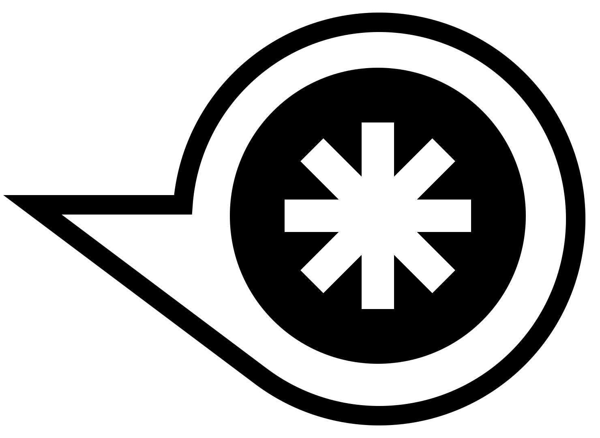

<p align="center">
  <picture>
    <source media="(prefers-color-scheme: dark)" srcset="docs/logo/rocinante-logo-dark.svg">
    
  </picture>
</p>

# rocinante

> _Y así, después de muchos nombres que formó, borró y quitó, añadió, deshizo y tornó a hacer en su memoria e imaginación, al fin le vino a llamar Rocinante: nombre, a su parecer, alto, sonoro y significativo de lo que había sido cuando fue rocín, antes de lo que ahora era, que era antes y primero de todos los rocines del mundo._
>
> Miguel de Cervantes, _El ingenioso hidalgo don Quijote de la Mancha_, Part I, Chapter 1 (1605)[^expanse]

```
circle at 100 100 radius 50
```

That line is a complete rocinante sketch. Run it and a window opens with a circle in it.

rocinante is an open-source creative coding framework with its own small and easy to learn, language. It comes out of years of working with [Processing](https://processing.org/), [openFrameworks](https://openframeworks.cc/) and [Cinder](https://libcinder.org/), and it borrows the turtle from [Logo](https://el.media.mit.edu/logo-foundation/). The goal is to make coding FUN AGAIN, especially for creative coders. You write a line and get a picture, mistakes come with a plain explanation, and when you save the file the running sketch updates.

Read [MANIFESTO.md](MANIFESTO.md) for why it exists.

## Status

Early, but you can write and run sketches today. The language exists and the `roci` command works:

- **`roci run`** runs a sketch (or a folder, through its `sketch.roci`). Save the file and the running sketch updates, keeping its values where it can; a mistake is shown over the picture while the last good version keeps running, and it recovers when you fix the file. Ctrl+R or Cmd+R starts it again from the first line, and Ctrl+Q or Cmd+Q quits.
- **`roci check`** reads a sketch and says what is wrong, in plain words with your own line fixed (`--errors json` gives the messages as data). **`roci fmt`** writes sketches in one house style. **`roci man rect`** shows how a verb is written.
- **`roci new`, `roci init` and `roci add`** make a sketch folder (with git, and Git LFS if you want it) and copy files into its `assets/`. **`roci get`** copies a library from a git address into `libs/`, and **`roci update`** fetches a newer copy and says what changed.
- **A sketch can be several files.** Every `.roci` file in a sketch folder is part of the same program: put verbs and constants in `palette.roci`, use them in `sketch.roci`, and messages name the right file. Save any of them and the sketch reloads (see `examples/starfield`). Libraries are folders in `libs/` brought in with `use "name"` (see `examples/constellation`), copied there from a git address by `roci get`.
- The language so far has drawing, style and colour, gradients, transforms, random numbers and noise, lists and records, verbs you teach with `learn`, `if`, `repeat`, `for`, `while`, the list verbs (`keep`, `collect`, `sort`, `shuffle` and more), keys, the mouse and fingers (`on key`, `on mouse down right`, `on touch down`, `pressed`, `held "space"`, `wheel`, `touches`), `floor`, `round` and `ceil`, `every`, tweens and easing, tables, the turtle, 2D collision (`touching`, `contact`, `hits`, `inside`, `cast`), messages between windows, and windows you can size, fix, move, make borderless or keep on top, read from (`main_window.width`) and change with `set`. Text, user interface widgets, images, sound and 3D come in later phases.

Under it is the engine, which also has an Odin API (and a C API). It draws on macOS (Metal), Linux and FreeBSD (Vulkan), Windows (Direct3D 12), and on an iPhone and an Android phone, and 100,000 circles a frame hold about 60 frames a second on the computers tried so far. Packaging a sketch into an app (`roci package`) is not written yet.

Phase 0 (2026-10-27) tested the riskiest parts with four spikes: a window and GPU device on every desktop system, a shader-drawn circle on a real iPhone and a real Android phone, generating Odin from a typed IR, and Dear ImGui with a screen reader. Phase 1, the window and the 2D core, is built and measured on all of them. Phase 2, the language itself, was closed on 2026-10-30, after a test with newcomers confirmed its design; Phase 3 (text, user interface widgets, images, canvases and shaders) is next. The design and the plan live in [CLAUDE.md](CLAUDE.md) and [docs/design.md](docs/design.md), which are kept up to date as decisions are made.

## What it looks like

```
particles = []
repeat 200 [ add { pos: { random width, 0 }, vel: { 0, random 3 } } to particles ]

learn step p [ p.pos = p.pos + p.vel ]

draw [
  background 0
  for each p in particles [ step p  circle at p.pos radius 3 ]
]
```

The first part runs today (it is a falling shower of circles). There are no semicolons and no setup function. Comments start with `//`, blocks use `[ ]`, `{ a, b }` is a vector, you teach new verbs with `learn`, and, in a later phase, sliders, buttons and text boxes will be ordinary words:

```
ui [ size = slider "size" 10 200 ]
draw [ circle at 200 200 radius size ]
```

## How it works

The core is written in [Odin](https://odin-lang.org/) and draws through the GPU API of [SDL3](https://libsdl.org/), which uses [Vulkan](https://www.vulkan.org/), [Metal](https://developer.apple.com/metal/) or [Direct3D 12](https://learn.microsoft.com/en-us/windows/win32/direct3d12/directx-12-programming-guide) depending on the platform. There is no OpenGL anywhere.

You use one command, `roci`. `roci run` runs a sketch and reloads it whenever you save. It interprets the sketch, so it works without installing anything else. `roci package <target>` compiles the sketch to native code through Odin and turns it into an app. Packaging fetches the right version of Odin for you and needs your platform's usual build tools (Xcode, MSVC or clang), and `roci doctor` lists what's missing and how to install it.

The same sketch file runs on FreeBSD, Linux, macOS, Windows, iOS and Android. You write, run and package sketches on a FreeBSD, Linux, macOS or Windows computer; iOS and Android are targets only, where the packaged app runs. Not every computer can package every target (an iOS app can only be built on a Mac), and `roci doctor` tells you which ones yours can.

## Roadmap

These are wanted, but not planned for the first stable release:

- **A rocinante shader dialect.** Shaders are written in HLSL for now. Later, a small shader language in rocinante's own style will compile to HLSL.
- **A web target**, so sketches can be shared in a browser.
- **More processors on the desktop.** The first stable release runs on x86-64 computers with FreeBSD, Linux or Windows, and on Macs with Apple silicon. Later: arm64 FreeBSD, Linux and Windows computers, and Intel Macs.
- **3D physics** (gravity, joints and stacking in 3D). Collision detection works in 2D and 3D, and physics simulation in 2D.
- **Training models** inside rocinante. For now, trained models run locally but are trained elsewhere.
- **Help for writing sketches with AI assistants**: a sketch-writing skill and an MCP server built on `roci`'s checker and headless run.
- **Editor tools in the source**: inline sliders and colour pickers that edit the number in your file, and a frame scrubber that steps backwards through a running sketch.
- **Turtle export** to plotter and embroidery formats.
- **Translated keywords and error messages.**

## Contributing

Issues and pull requests are welcome here on GitHub.

Day-to-day development happens in a self-hosted GitLab, and this repository is a mirror updated about twice a week. When a pull request is accepted, it is merged there and arrives here with the next update, so it may show as closed rather than merged. Your commits keep your name as author.

The history is linear: branches are rebased onto `main` and merged fast-forward. Keep commits small, one idea each, with a short imperative message prefixed by the area it touches, for example `gfx: batch circles with instancing`. The name is always written in lowercase, rocinante, including at the start of a sentence.

After cloning, turn on the project's git hooks once:

```
git config core.hooksPath tools/hooks
```

## Building

You need git, the Odin release named in `ODIN_VERSION` (check it with `odin version`) and SDL3, which the engine's tests link:

| System | Odin | SDL3 and the rest |
|---|---|---|
| Windows | the `windows-amd64` archive from Odin's [releases](https://github.com/odin-lang/Odin/releases), and Build Tools for Visual Studio with the C++ workload | comes with Odin: copy its `SDL3.dll` next to the programs (`cp "$(odin root)/vendor/sdl3/SDL3.dll" .`) |
| Arch, CachyOS, Manjaro | `sudo pacman -S odin` | `sudo pacman -S git clang sdl3` |
| Debian 13+, Ubuntu 25.04+ | the `linux-amd64` or `linux-arm64` archive (their `odin` package is another program) | `sudo apt install git clang libsdl3-dev` |
| Fedora 43+ | the `linux-amd64` or `linux-arm64` archive | `sudo dnf install git clang SDL3-devel` |
| FreeBSD | `sudo pkg install odin-lang` | `sudo pkg install git sdl3` |
| macOS | `brew install odin`, or the `macos-arm64` archive | `xcode-select --install`, then `brew install sdl3` |

Systems with no SDL3 package (Ubuntu 24.04, Debian 12) can build it with `tools/ci/install-sdl3.sh`, as the GitHub pipeline does. The [getting started guide](https://sandbenders.github.io/rocinante/guides/01-getting-started/) has every step. (An older Odin, `dev-2026-07` built against LLVM 23, failed to compile even a hello world, so check that `odin version` matches the file.) Then, from the repository root:

```
odin run build -- ci          # what the pipelines run
odin run build -- ci --fast   # what the pre-push hook runs
odin run build -- licences    # dependency licence check
```

The full `ci` also draws the golden images on Mesa's software Vulkan driver (lavapipe) when it is installed, and says so when it is not.

## Trying it

The documentation (guides, and a reference of every word with an example and the picture it draws) is at https://sandbenders.github.io/rocinante/, built from this repository: `odin run build -- docs` makes it locally, with [Hugo](https://gohugo.io) at the version in `HUGO_VERSION`.

Run a sketch (the examples are written in the language as `sketch.roci` files):

```
odin run cli -- run examples/garden/sketch.roci        # two windows: click, press 1 2 3, space and c
odin run cli -- run examples/two_windows/sketch.roci
odin run cli -- run examples/starfield                    # a sketch of two files: sketch.roci and palette.roci
odin run cli -- run sketch.roci --frames 60 --screenshot out.png   # headless, saves the last frame
```

The other commands:

```
odin run cli -- new mysketch                           # a sketch folder, with git; roci init does it in this folder
odin run cli -- add cat.png                            # copy a file into the right folder of assets/
odin run cli -- get github.com/someone/flocking          # copy a library into libs/ (then  use "flocking" ); roci update fetches newer copies
odin run cli -- check sketch.roci                      # say what is wrong, with the fix
odin run cli -- fmt                                    # write every .roci file here in the house style
odin run cli -- man rect                               # how a verb is written (no word: every verb)
```

Build the binary once with `odin build cli -out:output/roci -o:speed` and use `output/roci run sketch.roci` for a quick start.

The engine's own examples use the Odin API and open real windows:

```
odin run examples/circle              # the smallest sketch: one circle
odin run examples/garden              # the Phase 1 demo: a palette window and a garden
odin run examples/two_windows         # two windows that send each other messages
odin run examples/shapes              # every shape, a circle follows the mouse
odin run examples/benchmark -o:speed  # 100,000 circles a frame, with frame rate and timings
```

Add `-- 3` to any of these to close the window after three seconds. `examples/c/circle.c` is the same circle through the C API (`include/roci.h`, checked by `tools/abi-check.sh`).

## Versions

Releases use calendar versioning, `YYYY.MINOR.MICRO`: the year of the release, the feature release within that year counted from 1, and its fixes counted from 0. Releases before the first stable one are previews and carry their stage: `2026.1.0-alpha` is the first alpha, `2026.1.1-alpha` its first fix and `2026.2.0-alpha` the next. The first stable release is the first version without one.

## Licence

[Zero-Clause BSD](LICENSE) (0BSD). Use it for anything, with or without credit.

## Credits

rocinante is designed and built by Fabrizio Poltronieri (sandbenders) [fabrizio@fabriziopoltronieri.com], with help from Claude, Anthropic's AI assistant.

[^expanse]: Four centuries later the name went to a ship. In _The Expanse_, the novel series by James S. A. Corey (the pen name of Daniel Abraham and Ty Franck) that began with _Leviathan Wakes_ in 2011, the Rocinante starts out as the _Tachi_, a Martian navy gunship. The survivors of the ice freighter _Canterbury_ take it over and rename it Rocinante, and it carries them through all nine novels and the television series (Syfy from 2015, then Amazon Prime Video). It is a small ship that keeps flying when it has no business doing so.
